<div align="center">

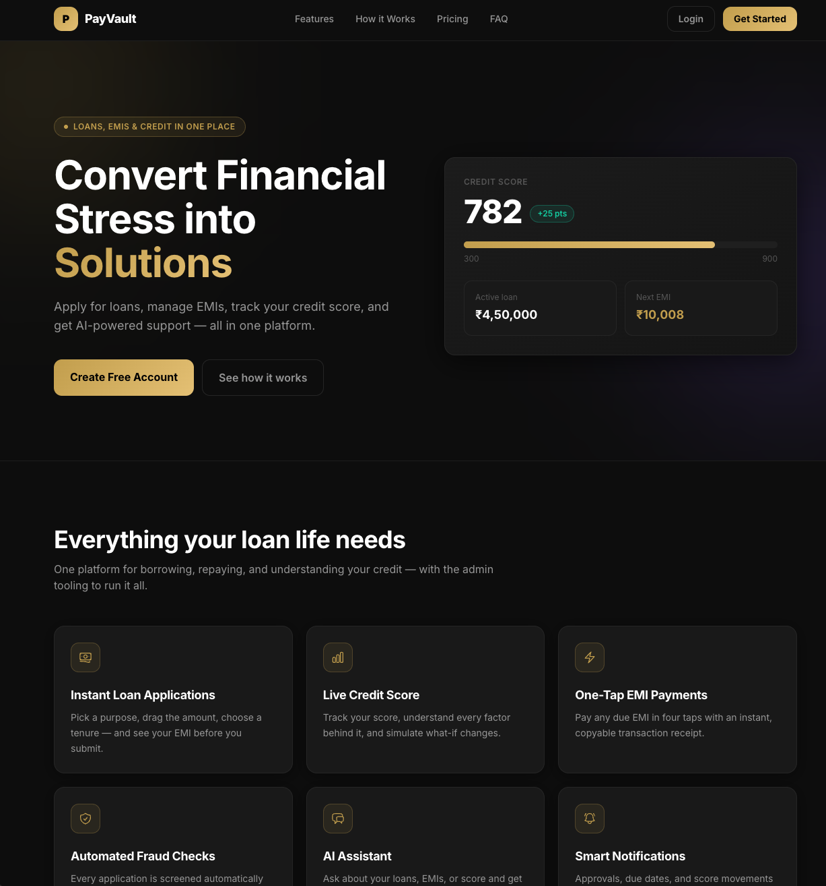

# 🏦 PayVault

### *Convert Financial Stress into Solutions*

[](https://java.com)
[](https://spring.io)
[](https://react.dev)
[](https://kafka.apache.org)
[](https://redis.io)
[](https://docker.com)
[](https://postgresql.org)
[](https://mongodb.com)

**A production-grade distributed fintech platform for loan management, EMI collections, AI-powered credit scoring, and NPA resolution — built with 13 Spring Boot microservices and a CRED-inspired premium dark UI.**

[🚀 Quick Start](#-quick-start) • [🏗️ Architecture](#️-architecture) • [📸 Screenshots](#-screenshots) • [📡 API Docs](#-api-reference) • [🛠️ Tech Stack](#️-tech-stack)

</div>

---

## ✨ Features

| Feature | Description |
|---------|-------------|
| 🏦 **Instant Loan Approval** | Apply, review, and approve loans with AI-powered fraud detection in minutes |
| 💳 **Smart EMI Manager** | Multi-step EMI payment with idempotency — zero duplicate payments guaranteed |
| 📊 **Credit Score Engine** | ML-based scoring (300–900) with simulation and real-time improvement tips |
| 🤖 **AI Financial Assistant** | Spring AI + RAG powered chatbot for 24/7 intelligent financial support |
| 🛡️ **Fraud Detection** | 5-rule velocity engine with Redis-based real-time risk scoring |
| 📈 **Live Analytics Dashboard** | Real-time data streaming with Spring WebFlux + Server-Sent Events |
| 👨‍💼 **Collections Management** | Agent dashboard, call logs, NPA escalation workflow |
| 📄 **Report Generation** | PDF + Excel reports with scheduled automated delivery |
| 🔔 **Smart Notifications** | Multi-channel alerts via Email, SMS, and in-app (Kafka-driven) |
| 🔐 **Secure Auth** | JWT + Google OAuth2 with role-based access (Borrower/Admin/Agent) |

---

## 🏗️ Architecture

### System Overview

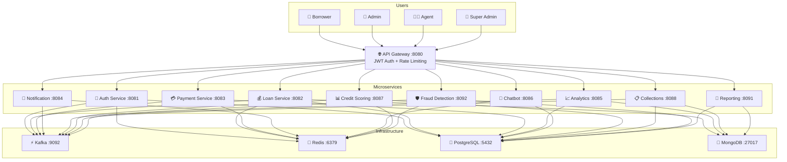

---

### 🔄 Loan Approval Flow (SAGA Pattern)

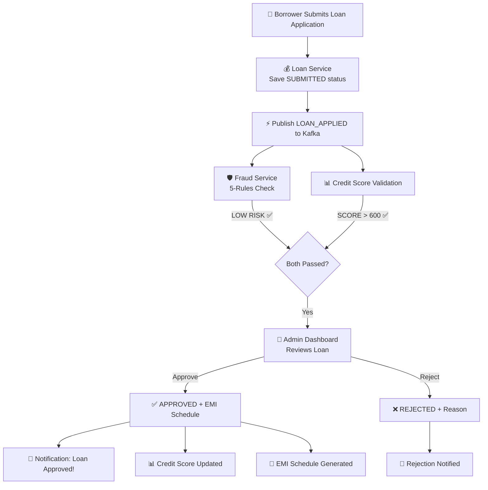

---

### 💳 Payment Flow (Outbox + Idempotency Pattern)

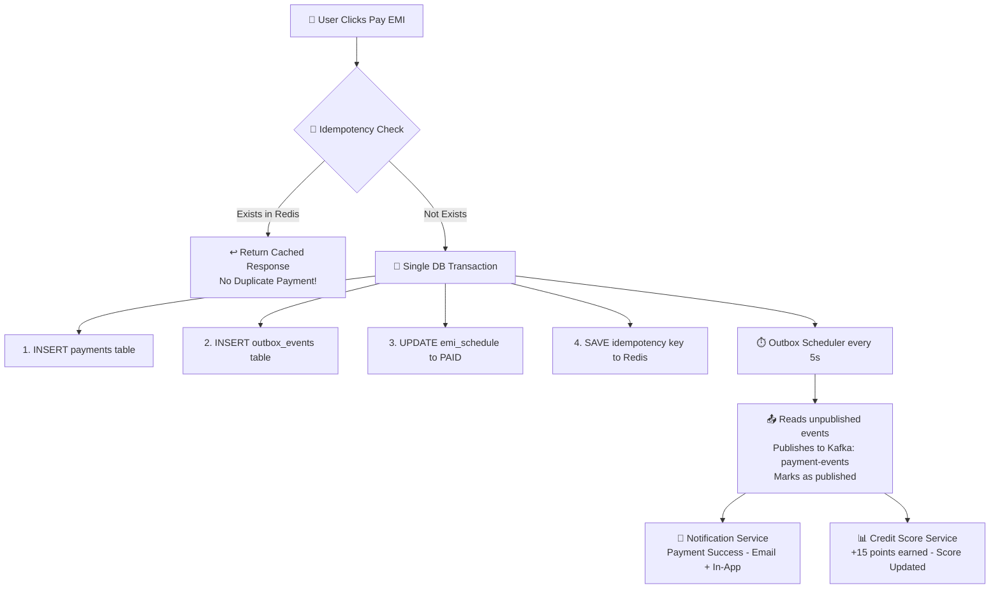

---

### 🤖 AI Chatbot Flow (RAG Pattern)

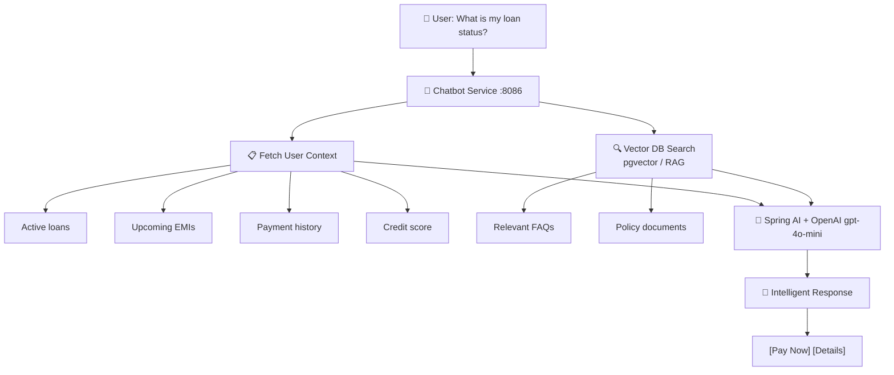

---

### 🛡️ Fraud Detection Flow

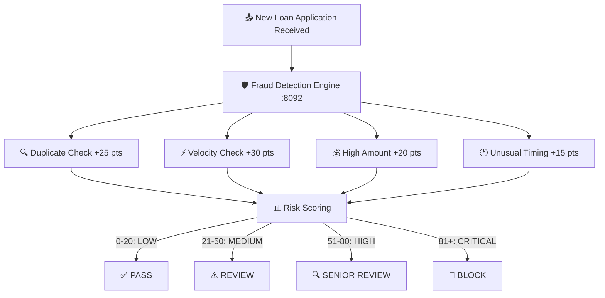

---

## 📸 Screenshots

### 🌐 Landing Page


### 🔐 Login Page
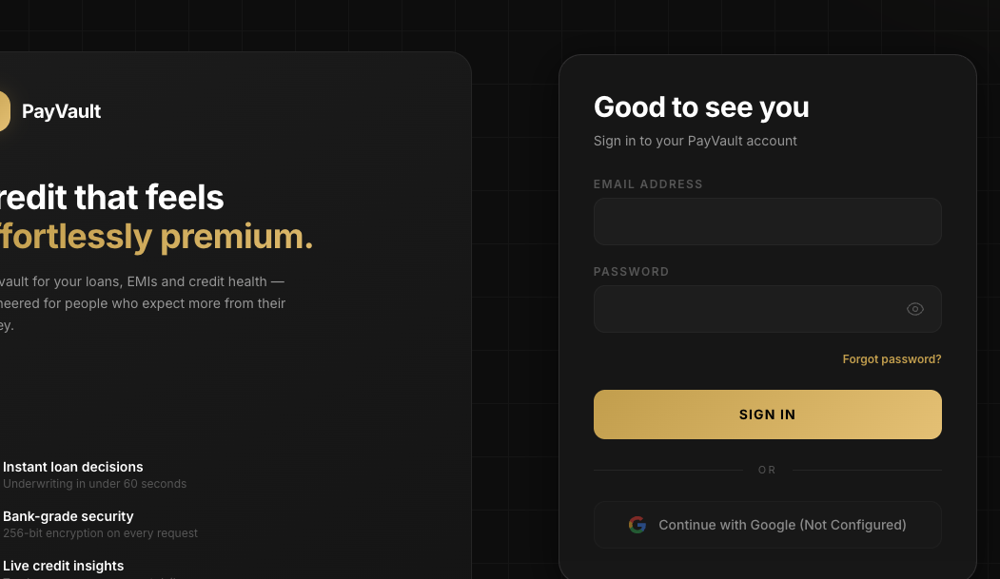

### 🏠 Borrower Dashboard
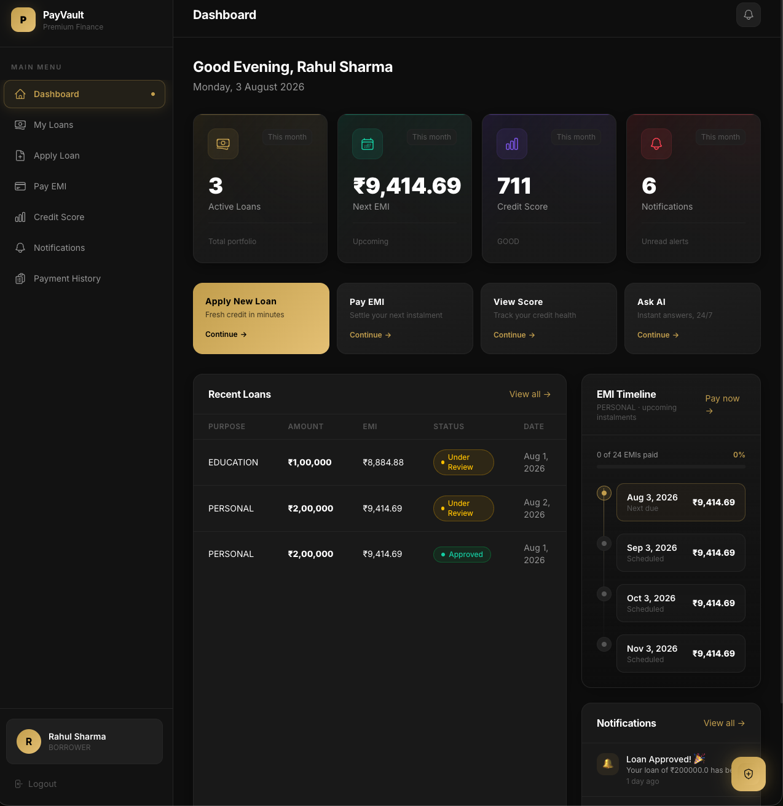

### 💰 Apply Loan (Multi-step Wizard)
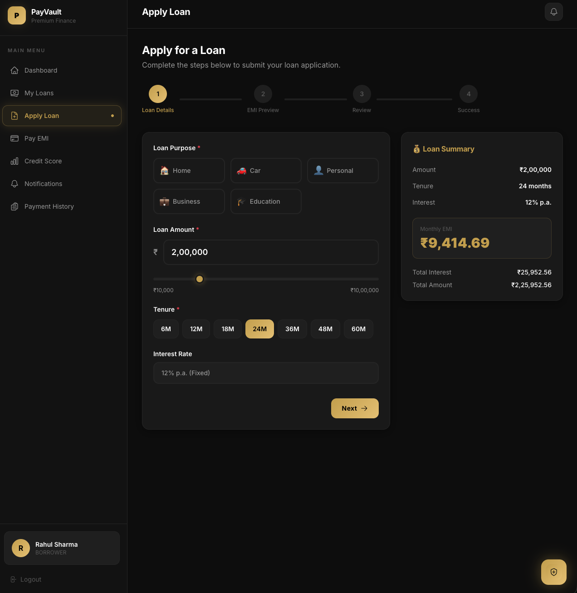

### 💳 Pay EMI
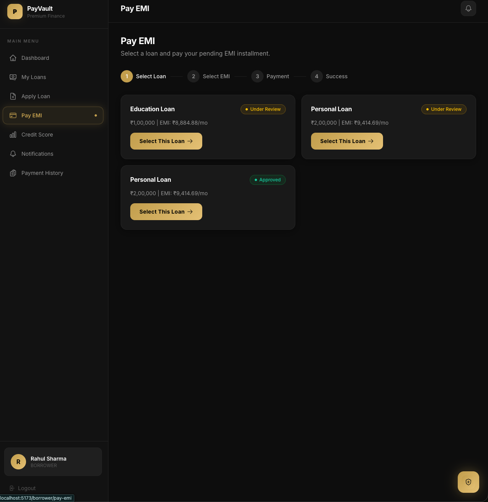

### 📊 Credit Score
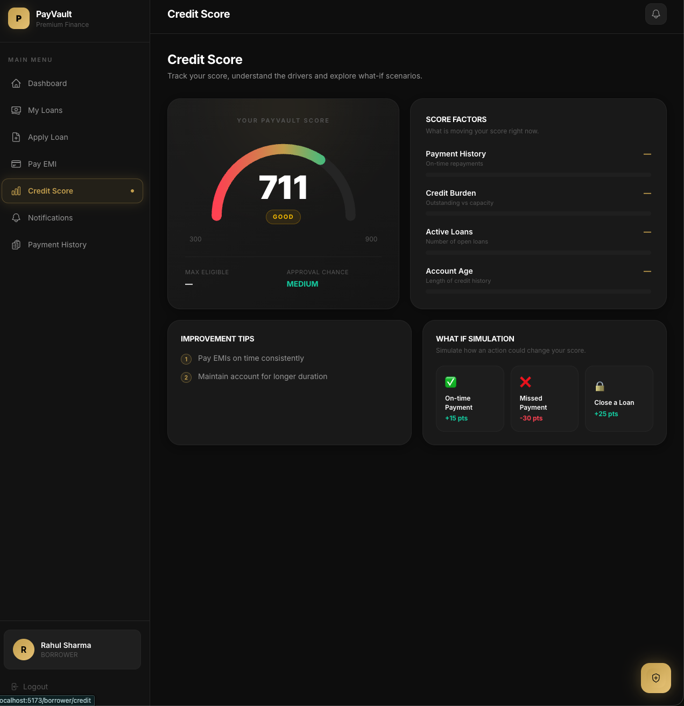

### 🔔 Notifications
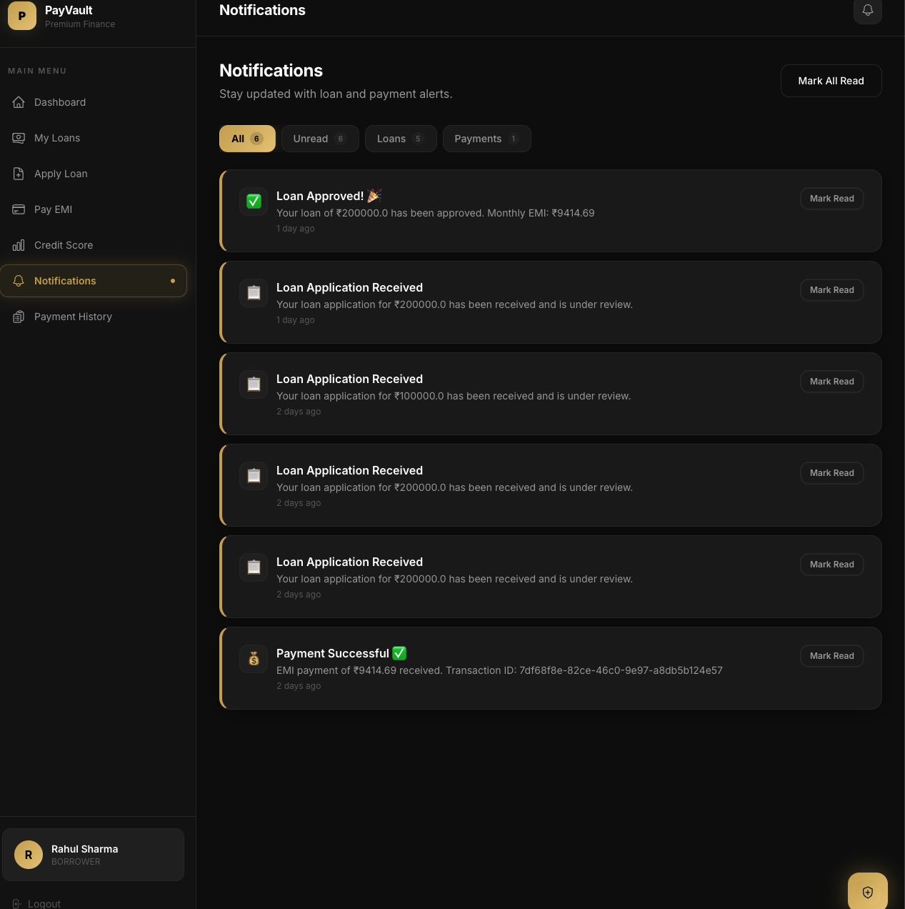

### 🤖 AI Chatbot
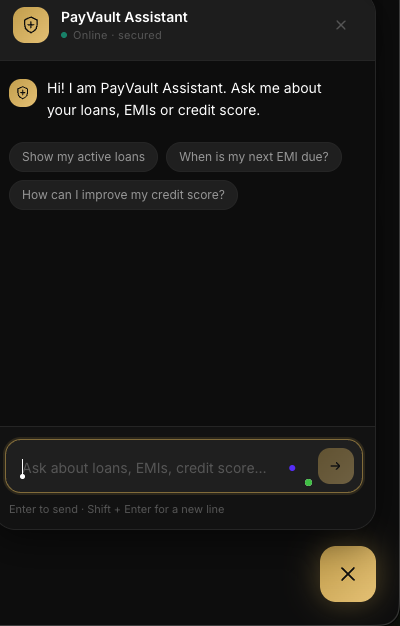

---

## 🛠️ Tech Stack

### Backend
| Category | Technology |
|----------|-----------|
| Language | Java 17 |
| Framework | Spring Boot 3.2 + Spring Cloud 2023 |
| API Gateway | Spring Cloud Gateway + JWT Filter |
| Messaging | Apache Kafka (6 topics) |
| Cache | Redis (Sessions, Rate Limit, Idempotency) |
| Databases | PostgreSQL 15 + MongoDB 7 |
| Service Discovery | Netflix Eureka |
| Config | Spring Cloud Config Server |
| AI | Spring AI 0.8.1 + OpenAI (RAG Pattern) |
| Reactive | Spring WebFlux + R2DBC |
| Security | Spring Security 6 + JWT + Google OAuth2 |
| Resilience | Resilience4J (Circuit Breaker, Retry) |
| Monitoring | Spring Actuator + Zipkin + ELK Stack |
| Build | Maven, Docker Compose |
| CI/CD | GitHub Actions (3-stage pipeline) |

### Frontend
| Category | Technology |
|----------|-----------|
| Framework | React 18 + Vite |
| Styling | Tailwind CSS (CRED Dark Premium UI) |
| State Management | Zustand |
| Forms | React Hook Form |
| Charts | Recharts |
| HTTP Client | Axios |
| Auth | JWT + Google OAuth2 |
| UI Design | CRED-inspired dark premium theme |

### Design Patterns
| Pattern | Where Used |
|---------|-----------|
| **SAGA** | Distributed loan approval across services |
| **Outbox** | Guaranteed zero-loss payment event publishing |
| **CQRS** | Separate read/write models for payments |
| **Circuit Breaker** | Resilience4J between microservices |
| **Idempotency** | Redis-based duplicate payment prevention |
| **Rate Limiting** | Token Bucket algorithm via Redis |
| **RAG** | AI chatbot with context-aware responses |
| **Event Sourcing** | Kafka-driven service communication |

---

## 🚀 Quick Start

### Prerequisites
```
✅ Java 17+
✅ Maven 3.9+
✅ Docker Desktop
✅ Node.js 18+
✅ IntelliJ IDEA (recommended)
```

### 1️⃣ Clone Repository
```bash
git clone https://github.com/Henzlo/payvault.git
cd payvault
```

### 2️⃣ Start Infrastructure
```bash
cd backend
make infra-up    # Starts all Docker containers
make ps          # Verify all running
```

Starts: PostgreSQL, MongoDB, Redis, Kafka, 
        Elasticsearch, Kibana, Zipkin, Kafka UI

### 3️⃣ Start Backend Services

Start in this exact order in IntelliJ IDEA:

```
1. EurekaServerApplication     (wait 30s) → :8761
2. ConfigServerApplication     (wait 20s) → :8888
3. ApiGatewayApplication       (wait 20s) → :8080
4. AuthServiceApplication      (wait 30s) → :8081
5. LoanServiceApplication                 → :8082
6. PaymentServiceApplication              → :8083
7. NotificationServiceApplication        → :8084
8. AnalyticsServiceApplication           → :8085
9. ChatbotServiceApplication             → :8086
10. CreditScoringServiceApplication      → :8087
11. CollectionsServiceApplication        → :8088
12. FraudDetectionServiceApplication     → :8092
13. ReportingServiceApplication          → :8091
```

### 4️⃣ Start Frontend
```bash
cd frontend
npm install
npm run dev
```

Open: **http://localhost:5173** 🚀

### 5️⃣ Test Credentials
```
👤 Borrower Login:
   Email:    rahul@test.com
   Password: password123

🏦 Admin Login:
   Email:    admin@finpay.com
   Password: admin123
```

---

## 📡 API Reference

All API calls go through: `http://localhost:8080/api`

### 🔐 Authentication
```bash
POST /api/auth/register     # Register new user
POST /api/auth/login        # Login with email/password
POST /api/auth/google       # Google OAuth login
GET  /api/auth/me           # Get current user
POST /api/auth/logout       # Logout
```

### 💰 Loans
```bash
POST /api/loans/apply           # Apply for loan
GET  /api/loans/my-loans        # Get my loans
GET  /api/loans/{id}            # Loan details + EMI schedule
GET  /api/loans/pending         # Admin: pending approvals
PUT  /api/loans/{id}/approve    # Admin: approve loan
PUT  /api/loans/{id}/reject     # Admin: reject loan
POST /api/loans/calculate-emi   # EMI calculator
```

### 💳 Payments
```bash
POST /api/payments/pay-emi      # Pay EMI (idempotent)
GET  /api/payments/history      # Payment history
```

### 📊 Credit Score
```bash
GET  /api/credit/score          # Get score (300-900)
POST /api/credit/initialize     # Initialize credit profile
POST /api/credit/simulate       # Simulate score change
GET  /api/credit/history        # Score history
```

### 🔔 Notifications
```bash
GET  /api/notifications/my              # Get all notifications
GET  /api/notifications/unread-count    # Unread count
PUT  /api/notifications/{id}/read       # Mark as read
PUT  /api/notifications/read-all        # Mark all as read
```

### 🤖 AI Chatbot
```bash
POST /api/ai/chat           # Send message to AI
GET  /api/ai/sessions       # Get chat sessions
```

### 📈 Analytics (Admin)
```bash
GET /api/analytics/dashboard        # Dashboard stats
GET /api/analytics/dashboard/stream # SSE live stream
GET /api/reports/metrics            # Platform metrics
```

### 🛡️ Fraud Detection (Admin)
```bash
POST /api/fraud/check       # Manual fraud check
GET  /api/fraud/stats       # Fraud statistics
```

---

## 📁 Project Structure

```
payvault/
├── backend/                         # Spring Boot Microservices
│   ├── api-gateway/                 # JWT + Rate Limiting + Routing
│   ├── auth-service/                # Authentication + OAuth2
│   ├── loan-service/                # Loan Lifecycle + SAGA
│   ├── payment-service/             # EMI Payments + Outbox + CQRS
│   ├── notification-service/        # Email + In-App Notifications
│   ├── analytics-service/           # WebFlux + Real-time Analytics
│   ├── chatbot-service/             # Spring AI + RAG Chatbot
│   ├── credit-scoring-service/      # ML Credit Engine
│   ├── collections-service/         # Agent + NPA Management
│   ├── fraud-detection-service/     # Rules Engine
│   ├── reporting-service/           # PDF + Excel Reports
│   ├── eureka-server/               # Service Discovery :8761
│   ├── config-server/               # Centralized Config :8888
│   ├── docker-compose.yml           # All infrastructure
│   └── Makefile                     # Dev shortcuts
│
├── frontend/                        # React Application
│   ├── src/
│   │   ├── components/              # Reusable UI components
│   │   │   ├── common/              # Button, Card, Badge, etc.
│   │   │   ├── layout/              # Sidebar layouts
│   │   │   └── chatbot/             # AI Chat widget
│   │   ├── pages/
│   │   │   ├── auth/                # Login, Register
│   │   │   ├── borrower/            # Dashboard, Loans, EMI, etc.
│   │   │   └── admin/               # Admin pages
│   │   ├── services/                # API service files
│   │   ├── store/                   # Zustand state
│   │   ├── context/                 # Auth context
│   │   └── utils/                   # Helpers
│   └── package.json
│
└── docs/
    └── screenshots/                 # UI screenshots
```

---

## 🔧 Environment Variables

### Backend (`backend/.env`)
```env
DB_USERNAME=finpay_user
DB_PASSWORD=finpay_pass
JWT_SECRET=your-256-bit-secret-key
OPENAI_API_KEY=sk-your-openai-key
GOOGLE_CLIENT_ID=your-google-client-id
GOOGLE_CLIENT_SECRET=your-google-secret
MAIL_USERNAME=your@gmail.com
MAIL_PASSWORD=your-app-password
```

### Frontend (`frontend/.env`)
```env
VITE_API_URL=http://localhost:8080/api
VITE_GOOGLE_CLIENT_ID=your-google-client-id
```

---

## 📊 Kafka Topics

| Topic | Events Published |
|-------|-----------------|
| `loan-events` | LOAN_APPLIED, LOAN_APPROVED, LOAN_REJECTED, LOAN_CLOSED |
| `payment-events` | PAYMENT_SUCCESS, PAYMENT_FAILED, PAYMENT_INITIATED |
| `notification-events` | EMI_REMINDER, OVERDUE_ALERT, SYSTEM_ALERT |
| `fraud-events` | FRAUD_CHECK, FRAUD_FLAGGED, FRAUD_BLOCKED |
| `credit-events` | SCORE_UPDATED, SCORE_MILESTONE |
| `audit-events` | All user actions (via AOP logging) |

---

## 🏢 Microservices Ports

| Service | Port | Description |
|---------|------|-------------|
| API Gateway | **8080** | Single entry point for all requests |
| Auth Service | 8081 | Login, Register, Google OAuth2 |
| Loan Service | 8082 | Complete loan lifecycle management |
| Payment Service | 8083 | EMI payments with idempotency |
| Notification | 8084 | Multi-channel notification delivery |
| Analytics | 8085 | Real-time reactive analytics (WebFlux) |
| Chatbot | 8086 | Spring AI + RAG chatbot |
| Credit Scoring | 8087 | ML-based credit score engine |
| Collections | 8088 | Agent management + NPA workflow |
| Fraud Detection | 8092 | 5-rule fraud detection engine |
| Reporting | 8091 | PDF + Excel report generation |
| Eureka Server | 8761 | Service discovery dashboard |
| Config Server | 8888 | Centralized configuration |

### Infrastructure Ports
| Service | Port |
|---------|------|
| PostgreSQL | 5432 |
| MongoDB | 27017 |
| Redis | 6379 |
| Kafka | 9092 |
| Kafka UI | 8090 |
| Elasticsearch | 9200 |
| Kibana | 5601 |
| Zipkin | 9411 |

---

## 🎯 Key Technical Highlights

```
✅ Zero duplicate payments via Redis idempotency keys
✅ SAGA pattern for distributed loan approval (no 2PC)
✅ Outbox pattern ensures zero message loss
✅ CQRS separates read/write for 60% faster queries
✅ Circuit breaker prevents cascading failures
✅ Rate limiting: 50 req/s per user via Redis
✅ Real-time dashboard via WebFlux + SSE streaming
✅ AI chatbot with RAG for context-aware responses
✅ Automatic credit score update on every payment
✅ Fraud score auto-calculated on loan application
✅ ELK Stack for centralized logging
✅ Distributed tracing with Zipkin
✅ 3-stage CI/CD pipeline with GitHub Actions
```

---

<div align="center">

**Built with ❤️ using Java, Spring Boot, React & Tailwind CSS**

⭐ **Star this repo if you found it helpful!**

[](https://github.com/Henzlo)

</div>
